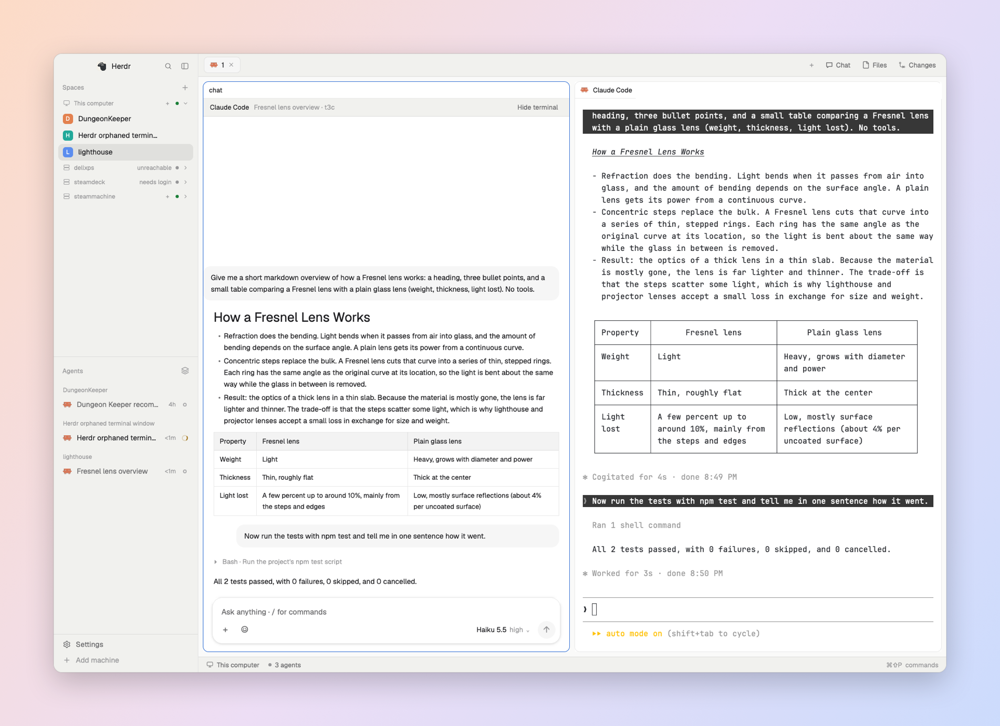
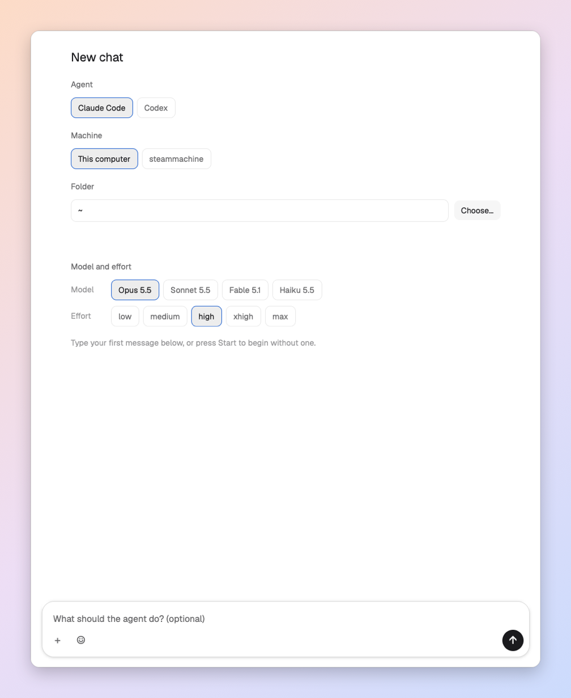
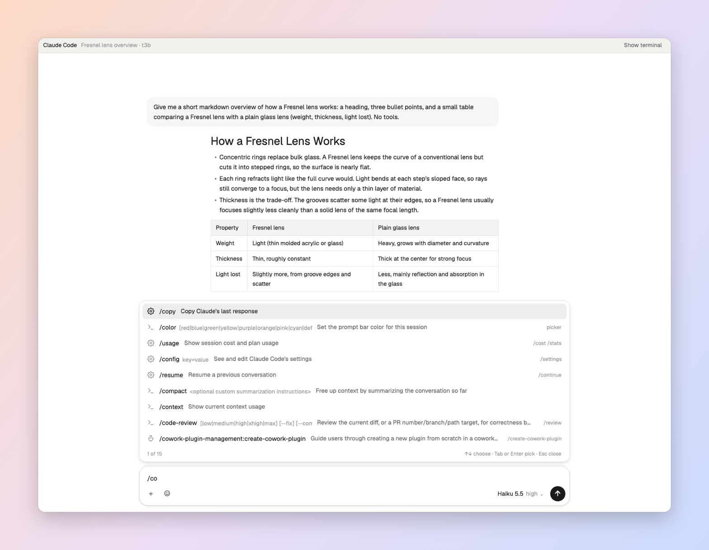
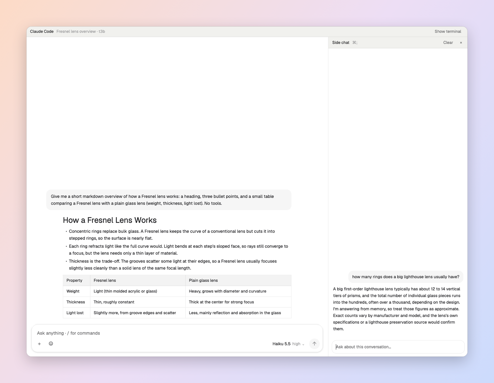
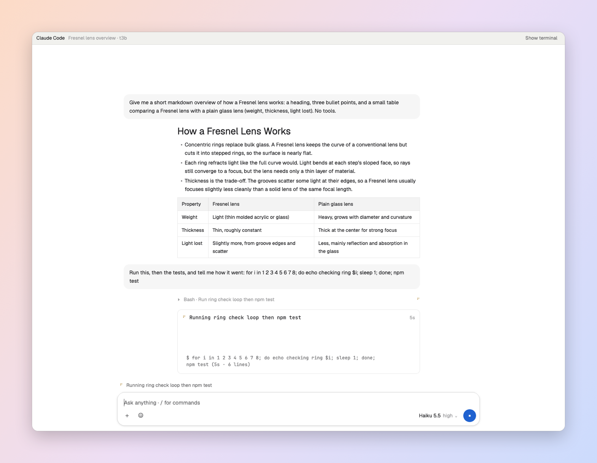
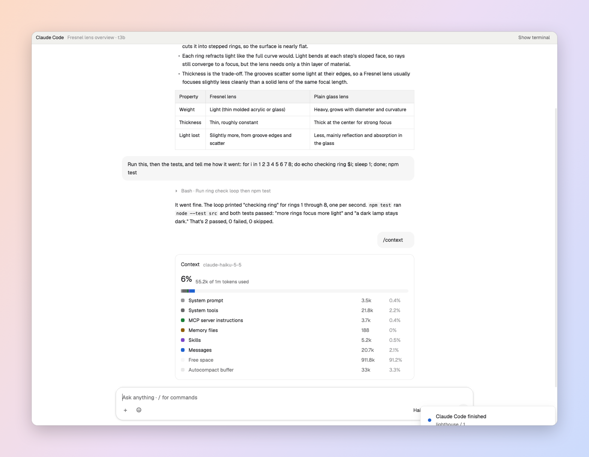
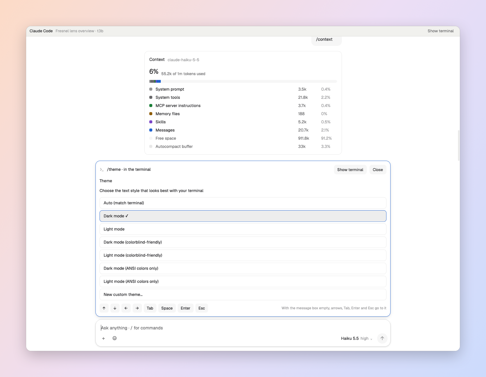
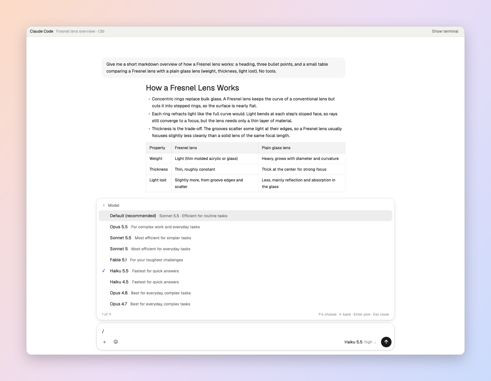
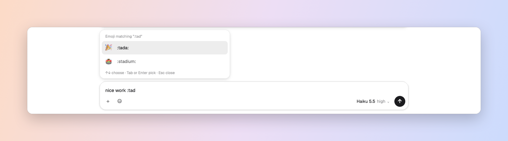

# Herdr Chat — Jarvis edition

This fork packages the customized layout used on our Macs. Install the **`customized` branch**:

> Read `~/.config/herdr-app/AGENTS.md`, then install the layout from
> https://github.com/XD-Open-Jarvis/herdr-chat/tree/customized.
> Preserve existing layouts, mods and keybindings; ask before replacing conflicts.

For a fresh install on another Mac, clone this branch and install all files together:

```sh
git clone --depth 1 --branch customized https://github.com/XD-Open-Jarvis/herdr-chat.git
cd herdr-chat
python3 scripts/install.py --install
```

The installer checks all five mods against the installed Herdr runtime first,
backs up replaced files under `~/.config/herdr-app/backups/`, updates the layout
and all runtime mod sources together, preserves conflicting shortcuts and selects
`chat`. It does not restart Herdr or alter existing sessions, Chat binding props,
transcripts or settings. It supports `HERDR_APP_HOME` / `--home` for a separate app home.

If Chat is already installed, use `python3 scripts/install.py --update` to replace
only its layout/mod files with backups. `--install` refuses existing Chat names.
Neither mode reads or writes core session documents. Connect the second Mac to
Mini separately; installing a layout does not establish the connection.

Read-only diagnosis: `python3 scripts/install.py --diagnose` reports the Herdr
version, missing/outdated runtime files, required header routing and app errors.
If the Mac is still sluggish, provide that output; updating the files alone does
not establish the cause of every terminal performance issue.

Changes from upstream:
- **Chat is a client-local view, not another shared pane.** Terminal mode shows
  the original split tree. 对话 opens the selected terminal's Chat across the
  tab content area; 终端 restores the original splits and focuses that terminal.
  Chat has no split controls and consumes pane-structure keyboard shortcuts.
  Other layouts and mobile clients continue seeing the original TUI panes.
  Opening or switching views never creates, closes, parks or zooms shared panes.
  Old Chat panes remain untouched; installation does not migrate session data.
- **Remote identity follows the original terminal pane.** The personal layout
  saves local terminal/tab/pane IDs. Runtime addresses use the owning pane's
  current client connection prefix. Missing or ambiguous owners are rejected.
- **More readable chat.** Base text is 15 px, tuned against the Alma reference. Image bounds:
  message/expanded tool images 420×300, collapsed tool thumbnails 312×215,
  attachment previews 144×108 logical pixels, preserving aspect ratio without upscaling.
- **Log watching stays bounded.** Quiet polling reuses one pending folder watch,
  and file changes cancel the fallback timer. This avoids abandoned host tasks
  accumulating when the timeout wins a Promise.race.
- **Hidden chats suspend background work.** While the TUI or another tab is
  visible, Chat skips transcript UI construction, terminal screen scraping,
  session lookup and log polling. Returning to Chat resumes log catch-up.
  This removes avoidable work during terminal scrolling; it is not a claim
  that every native terminal or agent-TUI scrolling issue is fixed.
- **hc-delivered input appears in the transcript.** Transport envelopes such
  as `<hc from="t1">hello</hc>` display as user messages with a small sender
  label. Internal environment/task messages remain filtered.
- **Fresh terminals also have the view selector.** Supported Claude/Codex panes
  show 对话 / 终端 before any chat has been created. The first Chat selection
  opens a client-local conversation view without creating a pane.
- **Pending border writes are deduplicated.** A delayed or rejected layout change
  is not resent on every redraw.
- **One Alma-style conversation header.** A 44 px bar shows workspace / session
  title on the left, and 对话 / 终端 on the right. The redundant `chat` title
  and inner agent toolbar are replaced by this single header. Search remains
  available in chat mode and with the existing keyboard shortcut.
- **Move to chat recovers after closing a chat in another layout.** A stale
  `chat.tab` label no longer suppresses the button. Existing hidden chats still
  offer Back to chat, including on remote machines.
- **One visible pane uses its normal border.** Rounded borders and headers remain;
  only the focus accent is suppressed. A zoomed split counts as one visible pane.
  Multiple visible panes retain the accent on the focused pane. The tab-bar mod
  updates this automatically when tabs, splits or zoom change.
- **New chat: ⌘⇧N on macOS / Ctrl+Shift+N elsewhere.** Merge the supplied keybinding
  rather than overwriting `keys.json`. Existing ⌘N / Ctrl+N bindings stay intact.
- Includes a layout-picker preview at `layouts/chat.svg`.

The original `main` layout and machine/session state are not included or changed.
Requires Herdr App with `layout.set`, `panes().zoomed` and the APIs used by the
upstream mods. Requires `python3` and an installed/authenticated Claude Code or Codex CLI.
The mods run programs, read agent session/config files, use agent connections and
can edit files through their file dialog; review the recipe before installing.

To install manually, download this branch into a separate folder, copy `layouts/chat.json`,
`layouts/chat.svg` and the five mod folders into the corresponding Herdr app folders
**only when those names are free**. For an existing install, back up your customized
files and review the diff before updating. Merge `keys.json`, run `herdr-app check`
on each mod, then `herdr-app do layout.switch '{"name":"chat"}'`.
Do not copy your other Mac's `shared.json`, `view.json`, `data/`, `.state/` or window files.

Regression checks: `node --test tests/*.test.mjs` (46 JavaScript tests; installer tests: `python3 -m unittest discover -s tests -p 'test_*.py'`).

---

# Upstream Herdr Chat

A chat window for [Herdr](https://herdr.dev) that sits over your Claude Code and Codex agents, with the terminal one click away. It works the way the Claude and ChatGPT apps do:
- a `/` command menu;
- a side chat that doesn't interrupt the agent;
- cards for context, usage, memory, MCP servers and settings;
- pickers drawn in the chat;
- replies that stream as they're written;
- Slack-style `:emoji` autocomplete.



*Herdr with the chat open: the spaces and agents on the left, and the chat beside its agent's terminal.*

| | |
|---|---|
| <br>**New chat** (⌘⇧N, or Ctrl+Shift+N on Linux and Windows): pick the agent, machine, folder, model and effort | <br>**The `/` menu**: skills, the model and all commands |
| <br>**Commands** with their descriptions, arguments and aliases | <br>**Side chat**: ask without interrupting the agent |
| <br>**Live progress**: the command running now and its output | <br>**Cards** for context, usage, MCP servers, memory |
| <br>**Terminal pickers** as buttons, right in the chat | <br>**Pick, don't type**: models, sessions, permission modes |
| <br>**`:emoji`** autocomplete, like Slack | |

## What the chat does that the terminal can't

- **Images, shown right in the conversation**:
  - **Yours**: attach them with **+**, drag them onto the chat, or paste a screenshot with ⌘V.
  - **The agent's**: images it reads or makes appear in its tool results, like screenshots it takes or diagrams it renders.
  - Click any image to open it full size.
- **Files by drag and drop**: drop any file on the chat to attach it. On another machine, it's copied there first.
- **Live progress**: while the agent works, its reply appears as it's written. The command or tool it's running shows too, with its output so far and how long it's been running.
- **Formatted replies**: markdown with headings, lists, tables and code blocks, and text you can select and copy. Replies are formatted while they stream, too.
- **Code blocks you can use**: every code block has **Copy** and **Play** buttons. With a terminal split beside the chat, Play runs shell code there (the one you clicked last); otherwise it puts the code in the message box, so a suggested command is one Enter away.
- **Tool calls folded away**: a turn's tool calls collapse into one line ("4 tool calls · Bash, Read, Edit"). Click it to see each call with its output and any images.
- **Questions as buttons**: when the agent asks for permission or asks you something, the choices appear as buttons you click. The same goes for the terminal's own pickers (`/theme`, `/export`, Codex's `/permissions`…).
- **Messages queued, not lost**: what you send while the agent works shows at once as a queued bubble. With Claude you can **Send now** (interrupt) or **Edit** it back into the box.
- **Side questions**: ask about the conversation in the side chat (⌘;) while the agent keeps working. Nothing there is added to its conversation.
- **Cards for the numbers**: context usage as a bar by category, plan limits and spend with progress bars, MCP servers with Reconnect and Disable buttons, memory and settings files that open in an editor.
- **Pick, don't type**: the model and effort from a menu, earlier sessions to resume from a list, the permission mode from a list. Commands come with their descriptions and the arguments they take.
- **A real text box**: multi-line editing, an emoji picker (☺) and `:emoji` autocomplete, and command chips.
- **`@` file mentions**: type `@` and part of a name to pick a file or folder from the agent's project.
- **Copy and edit messages**: hover a reply to copy it, or one of your messages to copy it or put it back in the box to change and send again.
- **Search the conversation**: ⌘F (Ctrl+F on Linux and Windows), or the search icon in the header, shows only the messages that match.
- **Permissions from the message box**: Claude's modes (Ask before edits, Accept edits, Plan, Auto, Bypass) or Codex's (Ask for approval, Approve for me, Full Access, Read Only), next to the model.
- **Move to chat**: a Claude or Codex terminal you started yourself gets a **Move to chat** button in the tab bar that opens it as a chat.

## Install

Ask the agent running in your Herdr: *"add the layout from github.com/XD-Open-Jarvis/herdr-chat/tree/customized"*. Or do it by hand:

```sh
git clone --branch customized https://github.com/XD-Open-Jarvis/herdr-chat
cd herdr-chat
cp -R mods/* ~/.config/herdr-app/mods/
cp layouts/chat.json ~/.config/herdr-app/layouts/
herdr-app do layout.switch '{"name":"chat"}'
```

Then merge `keys.json` into `~/.config/herdr-app/keys.json`. Its `secondary-shift-n` is New chat on ⌘⇧N on macOS and Ctrl+Shift+N on Linux and Windows. Existing Ctrl+N shell bindings are preserved.

**Requirements:**
- `python3`, and `claude` and/or `codex`, on the machine where the agents run.
- On Linux:
  - `kdialog` or `zenity` for the **+** file picker.
  - `wl-clipboard` or `xclip` (or KDE's Klipper) for `/copy` and pasting images.

To keep your own layout instead, point its pane header at `chat-pane` and its tab bar at `chat-tabs`. Optionally, point its spaces sidebar at `spaces-chat`. See [RECIPE.md](RECIPE.md) for how it all works.

## What's in it

| Folder | What it is |
|---|---|
| `mods/chat` | The chat itself |
| `mods/chat-file` | The editor dialog behind `/memory`, `/hooks` and `/config` |
| `mods/chat-pane` | The pane header: closing a chat or an agent's terminal asks first |
| `mods/chat-tabs` | The tab bar with a **Move to chat** button |
| `mods/spaces-chat` | The spaces sidebar with **New chat there** |
| `layouts/chat.json` | Herdr's main layout, using the mods above |
| `keys.json` | New chat on ⌘⇧N (macOS) or Ctrl+Shift+N (Linux and Windows), through `secondary-shift-n` |

## License

MIT, see [LICENSE](LICENSE).

### Codex conversation identification

Chat checks the terminal's current screen against structured user/assistant
messages in candidate logs. A match requires two distinct messages in screen
order with evidence unique to one candidate. Inherited fork history is read at
its recorded byte boundary and cannot distinguish parent and child by itself.
Startup arguments, modification times and old manual selections are not treated
as the current session identity.

If identification is uncertain, Chat hides the transcript and asks you to open
TUI, run `/status`, leave the status panel visible, and return to **Check again**.
Chat reads the displayed Session ID; it never sends `/status` automatically or
requires a Codex configuration change. Matching is conservative and bounded
(40 same-directory candidates, 4 MiB of combined history per candidate), so long
histories, insufficient visible text or unreadable logs can require this step.

Once verified, a Codex binding is persisted for its owning tab/pane/terminal
and checked against the foreground PID plus process start time. A later screen
with insufficient matching text does not revoke it. Mod/app reloads restore a
binding only after verifying that process identity. Explicit new session
identity replaces it; a displayed status for an unavailable session invalidates
it. In-place session changes still require new identity evidence: process
continuity alone cannot prove that no external `/fork` or `/resume` occurred.
