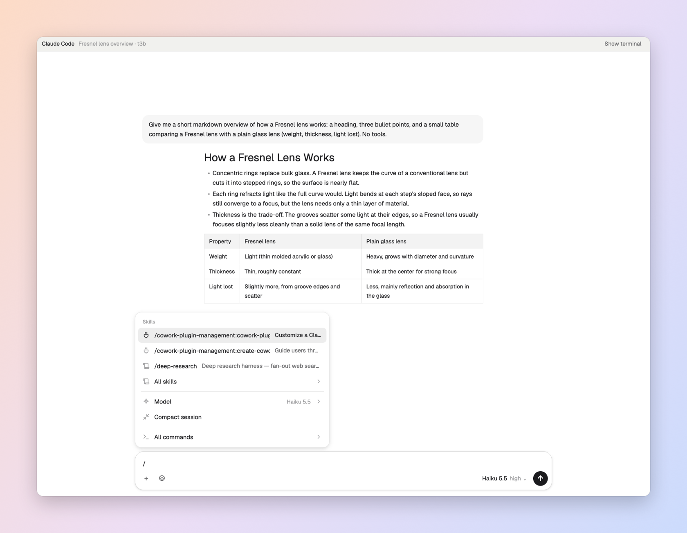
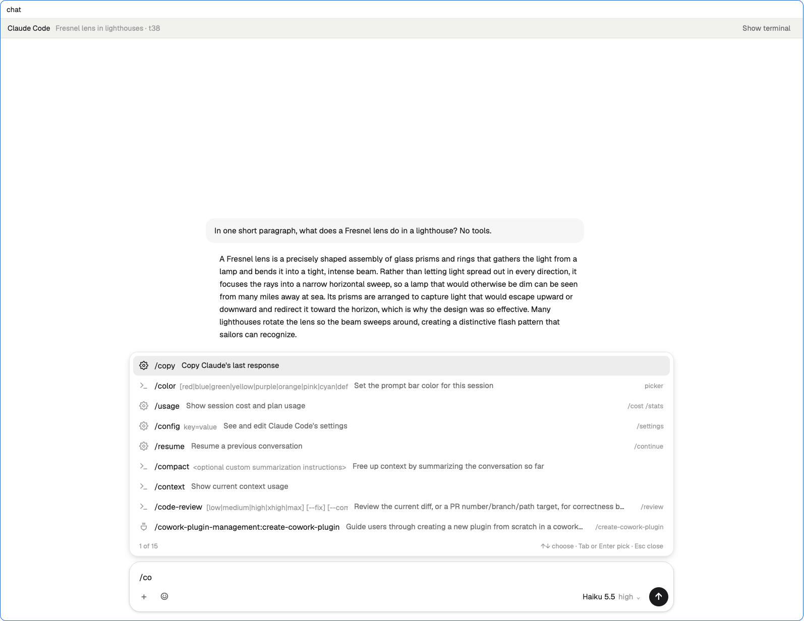
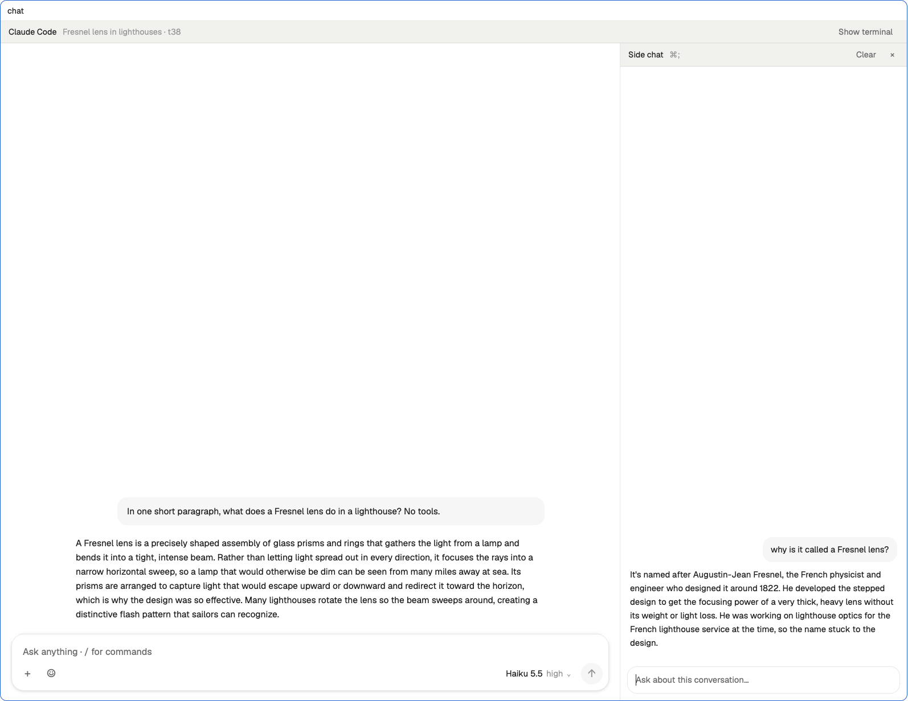
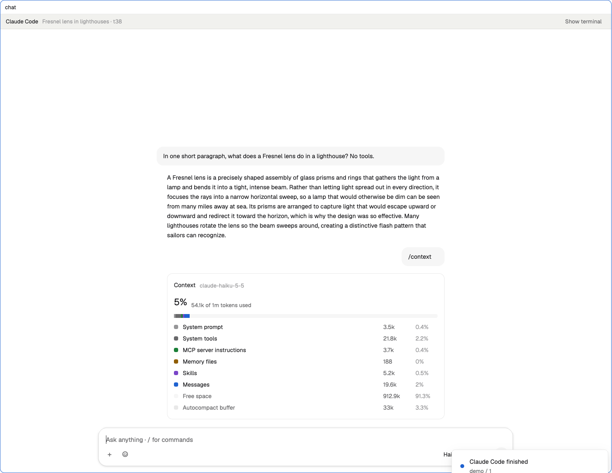
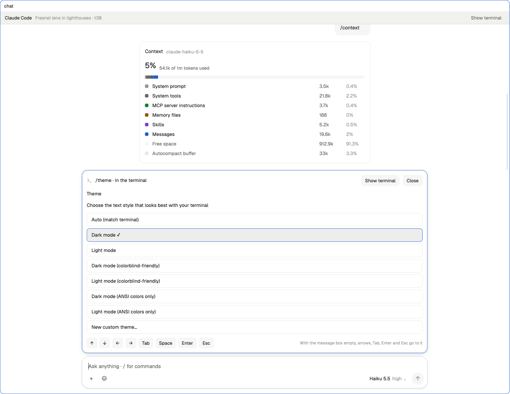
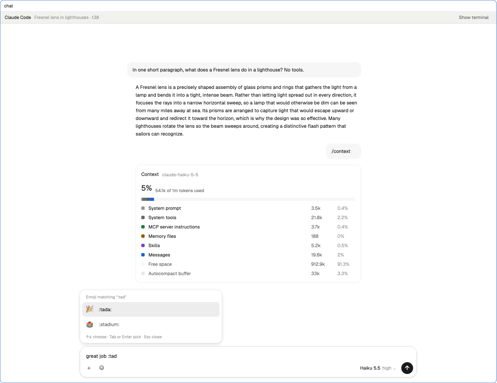
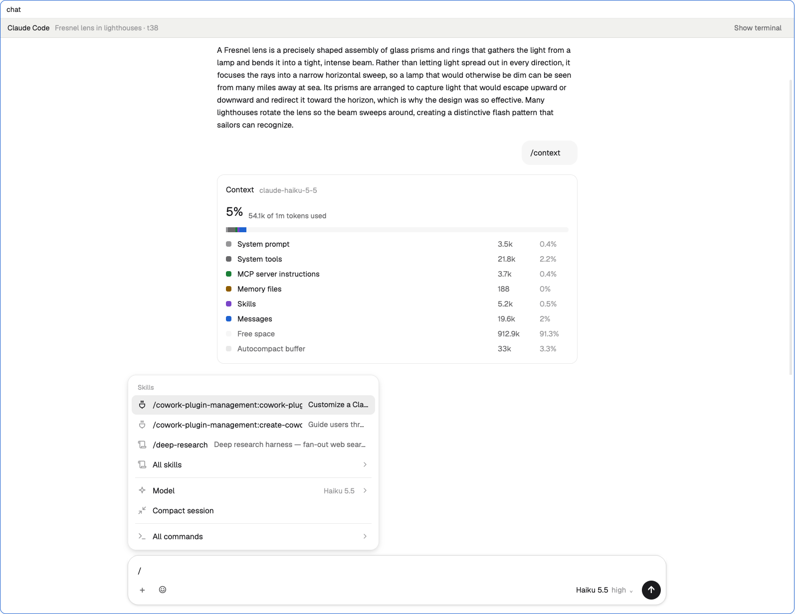

# Herdr Chat

A chat window for [Herdr](https://herdr.dev) that sits over your Claude Code and Codex agents, with the terminal one click away. It works the way the Claude and ChatGPT apps do:
- a `/` command menu;
- a side chat that doesn't interrupt the agent;
- cards for context, usage, memory, MCP servers and settings;
- pickers drawn in the chat;
- replies that stream as they're written;
- Slack-style `:emoji` autocomplete.



| | |
|---|---|
|  |  |
|  |  |
|  |  |

## Install

Ask the agent running in your Herdr: *"add the layout from github.com/naruse/herdr-chat"*. Or do it by hand:

```sh
git clone https://github.com/naruse/herdr-chat
cd herdr-chat
cp -R mods/* ~/.config/herdr-app/mods/
cp layouts/chat.json ~/.config/herdr-app/layouts/
herdr-app do layout.switch '{"name":"chat"}'
```

Then merge `keys.json` into `~/.config/herdr-app/keys.json` (it binds ⌘N to New chat).

**Requirements:**
- `python3`, and `claude` and/or `codex`, on the machine where the agents run.
- On Linux:
  - `kdialog` or `zenity` for the **+** file picker.
  - `wl-clipboard` or `xclip` (or KDE's Klipper) for `/copy` and pasting images.

To keep your own layout instead, point its pane header at `chat-pane` and its tab bar at `chat-tabs`. Optionally, point its spaces sidebar at `spaces-chat`. See [RECIPE.md](RECIPE.md) for how it all works.

## What's in it

| Folder | What it is |
|---|---|
| `mods/chat` | The chat itself |
| `mods/chat-file` | The editor dialog behind `/memory`, `/hooks` and `/config` |
| `mods/chat-pane` | The pane header: closing a chat or an agent's terminal asks first |
| `mods/chat-tabs` | The tab bar with a **Chat** button |
| `mods/spaces-chat` | The spaces sidebar with **New chat there** |
| `layouts/chat.json` | Herdr's main layout, using the mods above |

## License

MIT, see [LICENSE](LICENSE).
