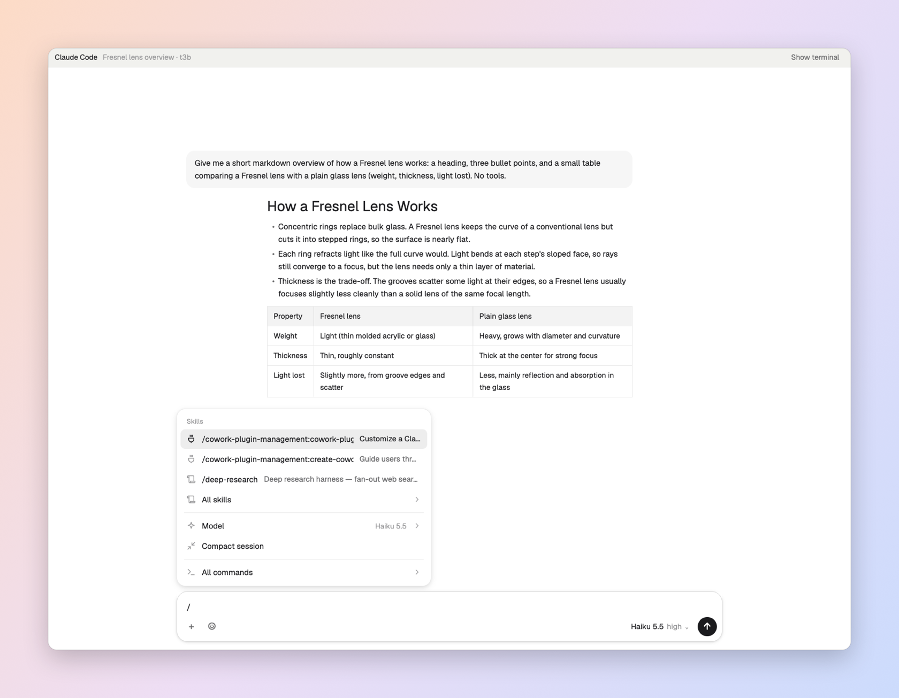

# Herdr Chat

A chat window for the Claude Code and Codex agents running in Herdr. It reads the agent's own session log and shows the conversation as messages, with images, tool calls and the reply streaming in as it's written. It sends what you type into the agent's terminal. It also brings over what the Claude and ChatGPT apps add on top of a terminal:
- a `/` command menu with chips;
- a side chat that never interrupts the agent;
- cards for `/context`, `/status`, `/usage`, `/memory`, `/hooks`, `/mcp`, `/skills`, `/plugin` and `/config`;
- pickers for the model, resuming a session and the permission mode;
- the terminal's own pickers, shown inside the chat;
- Slack-style `:emoji` autocomplete.

The terminal stays one click away.

## What you see

- **The chat pane** (`chat`). It opens zoomed over the agent's terminal in the same tab.
  - **Header** (32 px, `chrome` background): the agent's name ("Claude Code" or "Codex"), the session title, the terminal address, and a **Show terminal / Hide terminal** button on the right.
  - **Conversation**: centered in a column up to 900 px wide.
    - Your messages are `raised` bubbles on the right, sized to their longest line.
    - Replies are plain markdown on the left.
    - Tool calls fold into one line ("3 tool calls · Bash, Read") that opens on click.
    - Images show inline and open in the system viewer.
  - **While the agent works**: a spinner line ("Working…" or its own status) sits above the message box. The reply being written shows live, read from the terminal. So does the command or tool running now: a card with a spinner, its title (`Bash(npm test)`, `$ gh auth …`, `Running npm test`), its last 10 output lines and its elapsed time.
  - **Message box**: one card with rounded 18 px corners.
    - The text field grows from 1 to 10 rows.
    - Under it: **+** (attach files), **☺** (emoji grid), the model and effort button, and a round send button (■ while the agent works and the box is empty).
- **The `/` menu**: a card above the message box.
  - **With only `/` typed** (420 px wide):
    - *Skills*: your top three by use.
    - *All skills ›*
    - *Model ›*, with the current model on the right.
    - *Compact session*
    - *All commands ›*
  - **With a word typed**: one filtered list as wide as the message box. Each row shows a kind icon (app, built-in, skill, plugin, MCP), `/name`, the argument hint, the description, its aliases, and "picker" for commands whose terminal picker opens in the chat. A footer shows "N of M" and the keys.
- **Command chips**: a picked command sits in the box as a blue `/name` chip. Its argument hint and description show under the text.
- **Side chat**: a pane on the right of the conversation, 300–420 px wide.
  - Its header has "Side chat ⌘;", **Clear** and **×**.
  - Questions are bubbles; answers are markdown.
  - It has its own message box: "Ask about this conversation…".
- **Cards**: 620 px wide, `surface` background, with rounded 12 px corners.
  - **Context**: the percentage, tokens used out of the window, a bar split by category, and one row per category.
  - **Status**: the model, mode, folder, session, account and version.
  - **Usage**: tokens per model; for Claude, usage credits as a bar, plan limits and the day's tips; for Codex, the spend limit and rate windows.
  - **Memory, Hooks, MCP servers, Skills, Plugins, Settings**: rows with a status dot and small action buttons, then buttons such as "Edit your settings" or "Browse plugins".
- **Terminal picker panel**: an `accent`-bordered card over the message box.
  - Header: "/theme · in the terminal", **Show terminal** and **Close**.
  - Body: the picker's question and its options as clickable rows, the current one marked ✓. Otherwise it shows the picker's screen in the terminal font.
  - A row of key buttons: ↑ ↓ ← → Tab Space Enter Esc.
- **Emoji menu**: a 380 px card titled `Emoji matching ":tad"`, with 8 rows of an emoji plus its `:name:`.
- **File editor** (`chat-file`): an 820×600 dialog with the file's name and path, **Close** and **Save** (⌘S), and a code editor.
- **Elsewhere**:
  - The tab bar (`chat-tabs`) gets a **Chat** button next to Files and Changes.
  - The spaces sidebar (`spaces-chat`) gets **New chat there** buttons.
  - ⌘N opens the New chat form: pick the agent, folder, model and effort, then Start.

## How it behaves

- **Agent status**: *working* shows the spinner line and the streaming reply; the send button turns into ■ Stop. *blocked* shows the agent's question as clickable choices above the message box. *idle* and *done* show nothing extra.
- **Sending**:
  - Enter sends (Shift+Enter for a new line).
  - A message sent while the agent works shows as a faded "Queued" bubble; with Claude, as "Steering · read at its next step".
  - Claude's queued messages get **Send now** and **Edit**.
- **The `/` menu**:
  - It opens when the message starts with `/`.
  - ↑/↓ move the highlight. → opens a submenu and ← or Esc goes back.
  - Tab or Enter puts the highlighted command in as a chip (nothing is sent yet). A second Enter sends it.
  - Esc closes the menu.
  - Commands you send often move up.
- **Commands the chat answers itself** (they never reach the agent):
  - `/btw` and `/side` open the side chat.
  - `/model` (with nothing after it) opens the model submenu; `/effort` opens the model button's menu.
  - `/resume` lists earlier sessions in this folder and sends `/resume <id>`.
  - `/permissions` (Claude) lists the modes and presses shift+tab in the terminal until its footer shows the one picked.
  - `/status`, `/usage` (`/cost`, `/stats`), `/memory` (`/memories`), `/hooks`, `/mcp`, `/skills`, `/plugin` (`/plugins`) and `/config` (`/settings`) show cards.
  - `/help` opens All commands. `/diff` opens Herdr's Changes panel. `/copy [N]` copies a reply.
- **Every other command** goes to the agent as typed.
  - If a picker opens in the terminal, the panel shows it, live, until it closes.
  - While the message box is empty, the arrows, Tab, Enter and Esc go to the picker.
- **Side chat**:
  - Each question is answered from a read-only copy of the conversation. Follow-ups carry the earlier questions and answers.
  - ⌘; opens or closes the side chat.
  - It shows "Thinking…" while waiting, and an error line if there's no answer.
- **Emoji**:
  - `:` plus two letters, at the start or after a space, opens the menu. Slack's names come first, then Unicode names matched by any word.
  - ↑/↓, Tab or Enter put the emoji in place of `:xx`; Esc closes the menu.
  - A full `:smile:` turns into 😄 by itself.
- **Closing**:
  - The chat pane's × asks whether to end the agent ("End agent" closes both the chat and the terminal; "Keep running" closes only the chat).
  - The terminal's × asks the same question ("Hide terminal" keeps it running).
  - If the terminal ends anyway, the chat shows "This agent's terminal has ended." with **Close chat**.

## Built from

- **Layout** `layouts/chat.json` (a copy of `main`):
  - Sidebar: `workspace-chrome`, `spaces-chat`, `agents`, `workspace-chrome`.
  - Work column: `chat-tabs`, then the active tab with the `chat-pane` header on each pane, and the Files/Changes stack. `workspace-status` at the bottom.
- **`mods/chat`**:
  - `main.js`: the view.
  - `parse.js`: Claude's `~/.claude/projects/*/<session>.jsonl` and Codex's `~/.codex/sessions/**/rollout-*.jsonl` read into entries, including queue operations, `queued_command` attachments, `local_command` output, `/context` markdown, and Codex `token_count`.
  - `source.js`: finds the log from the terminal's foreground process.
  - `commands.js`: the command list.
  - `sdk.js`: requests to the agents.
  - `stream.js`: reads what the agent is doing from the terminal screen: the reply being written, or the running command or tool and its output.
  - `prompt.js`: parses terminal pickers.
  - `platform.js`: clipboard, file picker, open, image size.
  - `emoji.js` and `emoji-names.js`: shortcodes and 1,519 Unicode-named emoji.
  - `models.js`: models and effort, launching, switching.
  - `icons/`
- **Props**: `{ terminal, started?, model?, effort?, machine? }`. Opened as a dialog (`mod.open:chat`), it's the New chat form.
- **Talking to Claude Code** (`sdk.js`, through `python3`), as the Claude app does:
  - It runs a short-lived `claude -p --input-format stream-json --output-format stream-json --no-session-persistence` and sends control requests:
    - `initialize`: commands and models. It also waits 2.5 s for `system/commands_changed`, which adds plugin and MCP commands.
    - `side_question` with `history`, against `--resume <session> --fork-session`.
    - `get_usage`, `get_settings`, `get_hooks_listing`, `mcp_status` (sent after 5 s, once servers have connected).
  - It reads Claude's sessions from `~/.claude/projects/<folder>/`.
- **Talking to Codex**, as the ChatGPT app does:
  - It runs `codex app-server` over JSON-RPC, with `initialize` and `capabilities.experimentalApi`.
  - `thread/fork` with `{ ephemeral, excludeTurns, path, developerInstructions }`, then `turn/start`, for the side chat. The instructions are the ChatGPT app's side-chat instructions.
  - `model/list`, `thread/list` (all source kinds), `account/rateLimits/read`, `account/read`, `hooks/list`, `mcpServerStatus/list`, `skills/list`, `plugin/list`, `config/read`.
- **Herdr**:
  - `hc send`, `hc keys`, `hc read`, `hc interrupt`.
  - `pane.split`, `pane.zoom`, `pane.focus`, `pane.swap`, `pane.close`, `tab.close`, `layout.select` and `layout.show` for Changes.
  - `openOverlay` for `chat-file`, `notify`, `cx.bind_keys` with key contexts `ChatMenu`, `ChatMenuNav`, `ChatPanel` and `ChatRoot`.
- **Programs**:
  - `python3`, `claude` and/or `codex`, `sh`.
  - For the desktop: `pbcopy` and `osascript` (macOS); `wl-copy`, `xclip`, `xsel` or KDE Klipper over `qdbus`, `kdialog` or `zenity`, and `xdg-open` (Linux).
- **`mods/chat-pane`**: a copy of the shipped `pane` header whose × asks before ending an agent. Its method is called `closePane`, not `close`.
- **`mods/chat-tabs`**: a copy of the shipped `tabs` with the Chat button. It splits a chat pane to the right of the tab's agent and zooms it.
- **`mods/spaces-chat`**: a copy of the shipped `spaces` sidebar whose + opens the New chat form.
- **`keys.json`**: `cmd-n` → `mod.open:chat`.

## Watch out

- **Never name a View method `close`.** Herdr calls `close(cx)` itself when a copy goes away. A header whose close button was named `close` closed the focused pane, and with it chats and agents.
- **`run()` calls from a mod aren't ordered.** For steps that must happen in order (unzoom, focus, then swap), run `herdr-app do …` through `exec`, one after another.
- **The message box keeps ↑/↓ and Esc for itself.** Bind them with `cx.bind_keys` to actions under `"<YourContext> > Input"`, and set that `key_context` on the box's wrapper only while a menu is open. Tab and letters reach `on_key_down`; arrows and Esc don't.
- **Enter puts its line break into the box (at the cursor) before `submit` fires.** Strip line breaks before matching the text. After `set_value`, the cursor sits at the start: use `set_selected_range`, or `set_value("")` and then `replace(text)`.
- **Never send a lone `/` to Claude Code.** Its own menu runs its first entry.
- **Claude Code doesn't log `/btw` answers**, and newer versions log slash commands as `system/local_command`, not user messages.
- **Messages sent mid-turn** are logged as `queued_command` attachments.
- **Claude Code's permission modes cycle with shift+tab**: manual → accept edits → plan → auto. The footer names the mode ("manual mode on" is the default).
- **`hc send` from inside an agent's terminal wraps the text in `<hc from=…>`**, so commands sent that way aren't commands. The mod's own sends aren't wrapped.
- **Big app-server replies** (`plugin/list` is about 400 KB) break `exec` output: trim them in the helper.
- **Pickers mark the current choice with ✔ in the indent.** Some draw their top border with `▔`, not `─`.
- **Codex's footer** ("Worked for 40s") sits inside the reply's indent.
- **Remote machines**: the helpers run on the agent's machine (`exec … { on }`), but the file editor reads and writes this computer only.

## Done when

- `herdr-app check` passes for `chat`, `chat-file`, `chat-pane`, `chat-tabs` and `spaces-chat`.
- **Basics**: ⌘N, Start → a new space with the chat zoomed over a fresh agent, and the folder-trust question answered by itself. Sending a message shows it at once and the reply as it's written.
- **`/` menu**:
  - Typing `/` shows *Skills*, *Model ›* and *All commands ›*.
  - `/co` filters the list; ↓ moves; Tab puts a `/compact` chip in the box; Enter sends it.
- **Side chat**: `/btw what did I just ask?` answers in the side chat, and the terminal never shows the question. A follow-up remembers the first question. The same works in a Codex chat.
- **Cards and pickers**:
  - `/context` shows the context card.
  - `/status` and `/usage` show cards for both Claude and Codex.
  - `/model` lists the models with ✓ on the current one; picking another switches the agent.
  - `/permissions` → Plan mode turns the terminal's footer to "plan mode on".
  - `/resume` lists earlier sessions.
  - `/memory` → Open shows the file in the editor dialog.
- **Terminal pickers**: `/theme` shows the theme picker in the chat; ↓ moves its highlight in the terminal; Esc closes both.
- **Emoji**: `hi :ta` shows 🎉 🌮 🚕…; Enter gives `hi 🎉 `.
- **Closing**: the chat's × → End agent closes the chat and its terminal, and the tab if it was the last pane.
